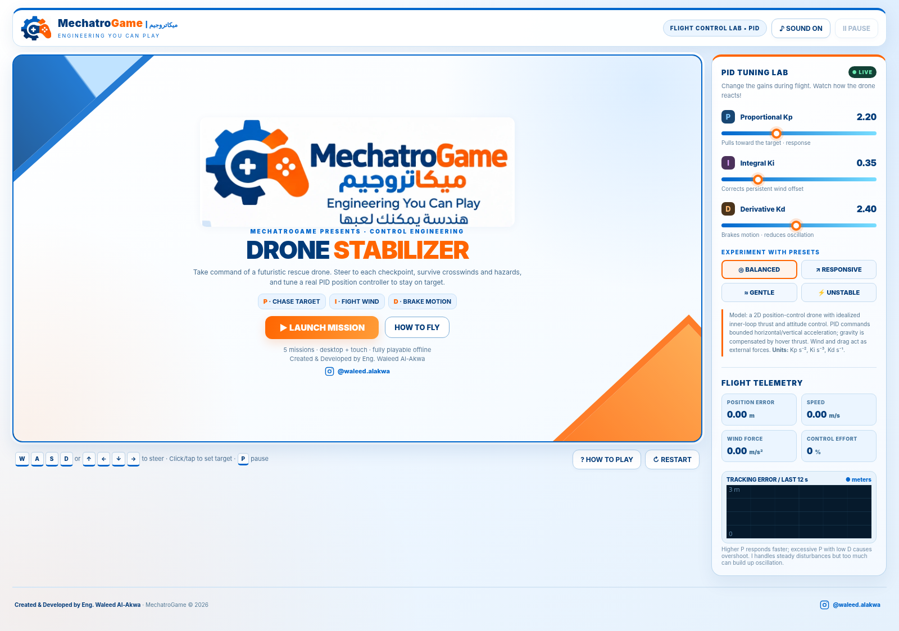
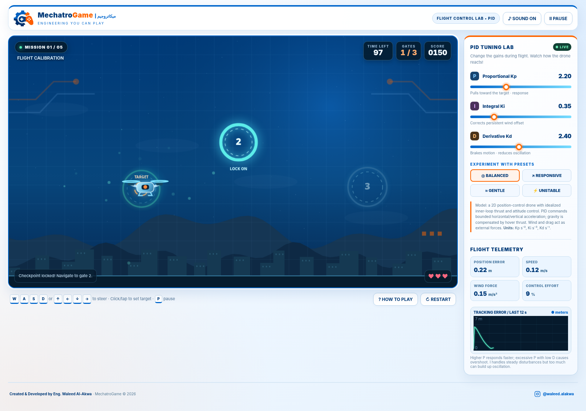
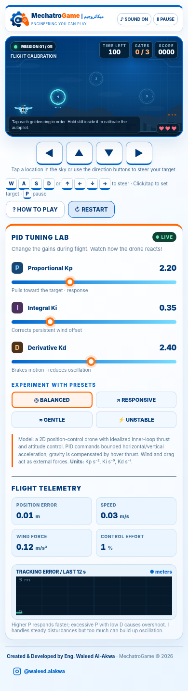

# Drone Stabilizer – MechatroGame

**A playable PID control laboratory built around a 2D drone flight challenge.**

Created and developed by **Eng. Waleed Alakwa** · **MechatroGame © 2026**  
[GitHub: @WaleedAlakwa](https://github.com/WaleedAlakwa) · [MIT License](LICENSE)



## Overview

**Drone Stabilizer** turns proportional–integral–derivative (PID) control into an interactive flight experience. Players guide a rescue drone toward ordered checkpoints while tuning three controller gains during flight. Wind, moving hazards, tight docking windows, and time limits make the effects of each tuning decision visible.

Instead of adjusting parameters in a static example, players experiment with a live closed-loop system and observe its response through the drone's movement, flight readouts, and a rolling tracking-error graph.

This is a **browser-based educational simulation**, not real quadcopter flight-control firmware. The game models planar position tracking and abstracts the inner attitude/thrust loops.

## Highlights

- **Live PID tuning:** Adjust proportional (`Kp`), integral (`Ki`), and derivative (`Kd`) gains at any point in a mission.
- **Four tuning presets:** Balanced, Responsive, Gentle, and Unstable demonstrate different control responses.
- **Five progressively challenging missions:** Practice tracking, reject crosswinds, avoid moving hazards, dock precisely, and complete a storm challenge.
- **Interactive setpoints:** Steer the target with a keyboard, by clicking or dragging within the arena, or using touch controls.
- **Flight telemetry:** Monitor target position error, speed, disturbance magnitude, controller effort, and tracking-error history.
- **Performance feedback:** Earn points by capturing checkpoints; score bonuses and mission ratings reward efficient, undamaged flight.
- **Self-contained implementation:** HTML, CSS, JavaScript, Canvas graphics, embedded imagery, and generated sound effects in one `index.html` file. No external JavaScript packages or build tools.

## Play

Open **[`index.html`](index.html)** in a current browser. Select **Launch Mission**, move the orange target toward the glowing checkpoint, and tune the PID values as the drone responds.

The game is intended to run without an internet connection. Its optional Instagram link opens an external website if selected. Browser support for Canvas, Web Audio, and local storage affects the corresponding features.

### Controls

| Input | Action |
|---|---|
| `W` `A` `S` `D` or arrow keys | Move the target position |
| Mouse click / drag on the flight arena | Place or move the target |
| Touch the arena | Set the target on a touch device |
| On-screen directional pad | Steer on narrow/mobile screens |
| `Shift` + direction | Move the target faster |
| `P` or `Space` | Pause or resume the mission |
| `R` | Restart the current mission |
| `H` | Open flight instructions |
| PID sliders | Change `Kp`, `Ki`, and `Kd` live |
| Tuning preset buttons | Apply an example gain configuration |

To capture a checkpoint, enter its ring **at low speed** and remain inside briefly. Touching hazards reduces drone integrity; losing all integrity or exceeding the mission timer ends the attempt.

## Mission progression

| Mission | Name | Control challenge |
|---|---|---|
| 01 | Flight Calibration | Learn to approach and settle at checkpoints |
| 02 | Crosswind Corridor | Compensate for a persistent side disturbance |
| 03 | Turbulence Alley | Maintain tracking around moving obstacles |
| 04 | Precision Dock | Reduce overshoot and slow down inside narrower gates |
| 05 | Storm Protocol | Balance all three terms through strong gusts and hazards |

Each stage introduces different wind/gust settings, gate layouts, speed thresholds, and hazards. See [Mission Design](docs/MISSIONS.md) for the values implemented in the game.

## The PID laboratory

The horizontal and vertical axes use the same position-control structure:

```text
position_error = target_position - drone_position
command = Kp * position_error + Ki * integrated_error - Kd * drone_velocity
```

The derivative term acts on measured velocity, helping reduce sudden kicks when the target moves. Acceleration limiting and conditional integration prevent the model from commanding unlimited thrust or accumulating large integral error under saturation. Simulated wind and linear drag act as external forces.

The **Balanced** preset starts at `Kp = 2.20`, `Ki = 0.35`, and `Kd = 2.40`. The other presets are deliberately different, including an oscillation-prone option for experimentation; they are not universal tuning recommendations.

For the equations, numeric bounds, integration method, and limits of the model, see [Control Model](docs/CONTROL_MODEL.md).

## Screenshots

<details>
<summary>Flight calibration and live tracking telemetry</summary>



</details>

<details>
<summary>Responsive layout with touch controls</summary>



</details>

## Implementation

| Component | Implementation |
|---|---|
| User interface | Semantic HTML and responsive CSS |
| Arena / drone / gates / obstacles | HTML Canvas 2D drawing |
| Controller and simulation | Plain JavaScript with fixed-step numerical updates |
| Tracking-error graph | A second HTML Canvas chart |
| Sound effects | Browser Web Audio oscillators (toggleable) |
| Best score | Browser `localStorage` where available |
| Image assets | Embedded WebP data images inside the HTML |

The simulation uses a fixed time step of **1/120 s** during active gameplay and renders through `requestAnimationFrame`. It is a simplified 2D model with abstracted hover thrust, not a hardware-validated drone dynamics model. Read [Control Model](docs/CONTROL_MODEL.md) for scope and assumptions.

## Project files

```text
Drone-Stabilizer-MechatroGame/
├── index.html                 # Complete offline-capable game
├── assets/
│   └── screenshots/
│       ├── main-menu.png
│       ├── flight-calibration.png
│       └── mobile-layout.png
├── docs/
│   ├── CONTROL_MODEL.md       # PID equations and physics assumptions
│   ├── MISSIONS.md            # Mission configurations and scoring
│   └── VERIFICATION.md       # Browser checks and tested scope
├── AUTHORS.md
├── CITATION.cff
├── LICENSE
├── THIRD_PARTY_NOTICES.md
└── README.md
```

## Verification and scope

The menu, mission startup, slider updates, preset restoration, pause/resume, sound toggle, and responsive/touch layout have been exercised in a Chromium browser session. A checkpoint was captured while the telemetry updated. The five-level progression has **not** been independently exhaustively playtested. See [Verification](docs/VERIFICATION.md) for the specific checks.

## Author, license, and attribution

**Eng. Waleed Alakwa** · [@WaleedAlakwa](https://github.com/WaleedAlakwa)  
Project identity: **MechatroGame — Engineering You Can Play**  
Copyright © 2026 Waleed Alakwa.

The original software and project documentation are distributed under the [MIT License](LICENSE). MIT permits reuse and modification, including commercial use, **provided the required copyright and license notices are retained**. It does not prevent others from modifying or redistributing the code, nor does it grant rights to misrepresent authorship or ownership of MechatroGame trademarks.

Please preserve attribution when using or adapting the work. Academic citations can use [CITATION.cff](CITATION.cff). The citation request is separate from the MIT license conditions. See [AUTHORS.md](AUTHORS.md) and [Third-Party Notices](THIRD_PARTY_NOTICES.md) for project-credit and branding context.
